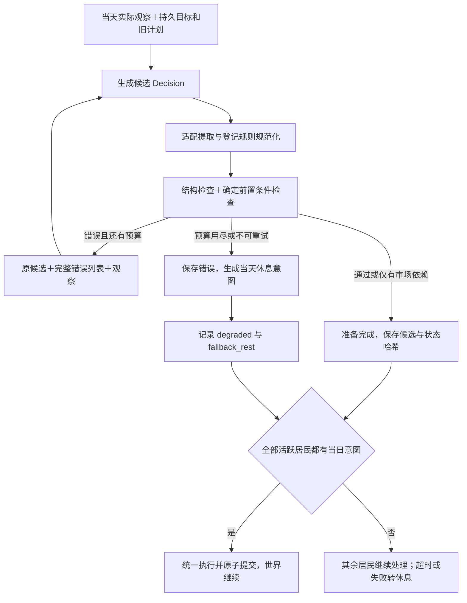

# Isleworks：可靠居民决策与多模型适配优化方案 v0.3

修订日期：2026-11-08。  
状态：已完成离线实现；真实 Strict 服务验收待执行。原 v0.1 文件路径保留。
项目目录：`/Users/lhl/Projects/Isleworks`。  
关联文档：[自主经济模拟系统 MVP](../product-specs/自主经济模拟系统_MVP_v0.1.md)、[实施记录](../exec-plans/completed/IMPLEMENTATION.md)。

## 1. 本次修订的核心决定

将设计重点从“用户选择两种模型输出模式”调整为：

**精简决策接口 → 生成阶段的结构约束 → 已知状态下的动作检查 → 有上下文的有限纠错 → 个体失败降级休息 → 汇集当日意图统一提交。**

单个居民没有成功生成计划，不阻塞其他居民，也不暂停世界。该居民当天使用程序生成的休息计划；食物消耗、缺粮和退出仍按原规则结算。

模型负责目标与选择，程序负责身份、协议、规则执行与资源账本。多模型适配作为这条链路中的小模块，隔离服务差异，不再作为本轮优化的主线。

本文件记录 v0.3 的设计与验收要求，实施结果见关联的实施记录。本次实现未直接查看或修改本机 `.env`，未迁移旧归档，未发起真实模型调用。

| 项目 | 本次决定 |
| --- | --- |
| 模型输出 | 使用精简 Decision，不直接生成完整内部 Plan |
| 确定性字段 | 居民身份、日期、计划 ID、订单 ID 由程序绑定 |
| 非法动作 | 在已知状态下尽量提交前检查，并反馈给模型修正 |
| 合法的坏选择 | 允许执行，不替居民自动优化策略 |
| 个体决策失败 | 有限纠错后降级为当天四块休息，不挂订单，世界继续 |
| 默认结构保障 | 使用当前 Provider 已验证的可靠结构化能力 |
| 用户配置 | 默认配置 Provider、模型和连接信息，不要求日常选择输出技术 |
| 实验记录 | 固定并记录实际输出机制和协议版本，禁止运行中静默切换 |
| 后续模型 | 通过小型适配器接入，复用同一 Decision 与世界核心 |

本轮不改变初始食物、产量、配方、消费、退出、市场撮合规则；不保证居民一定繁荣，也不以改变生存偏好来掩盖接口问题。

## 2. 从实际失败反推设计问题

归档 `dd05af706ed14b06a7306558ff025cda` 中，24 次请求仅 2 次通过校验，22 次失败。首个错误为：

| 错误 | 次数 | 设计上需要处理什么 |
| --- | ---: | --- |
| 额外 `type` | 16 | 传输标记混入业务数据 |
| 外层 `current_plan` | 3 | 输入观察与输出契约混淆 |
| 外层 `plan` | 2 | 模型自行增加包装 |
| 动作 `air` | 1 | 缺少生成阶段的枚举约束 |

通过校验的计划仍出现“需要四个连续制造块，却只安排两个”的执行错误。

根据用户确定的世界设计，失败后休息是本次保留并明确的行为：居民决策能力不足或未能取得可用计划，就损失当天生产机会。实现需要稳定执行这一策略，并在记录中区分模型主动休息、输出校验失败、网络故障和预算不足；这些来源不能混为同一种经济判断。

这些现象涉及不同问题，不能只用“提高提示词强度”或“更换输出模式”笼统解决。上述统计仅记录每份输出遇到的首个错误，移除外层包装不代表内层一定有效。

本方案区分四个层次：

| 层次 | 例子 | 处理 |
| --- | --- | --- |
| 传输与解析 | TLS、空内容、截断、非法 JSON | 记录、有限重试；未得到有效计划则该居民休息 |
| 协议结构 | 缺字段、类型错误、非法枚举 | 生成约束＋本地校验＋反馈 |
| 确定的动作前置条件 | 制造时间不够、出售未持有的物品 | 阻止提交，要求修正 |
| 经济判断与市场不确定性 | 投资过度、无人接受报价、库存安全边际不足 | 允许在规则内发生，记录后果 |

## 3. 新的模型交互接口

### 3.1 模型只提交需要选择的内容

定义与 Provider 无关的 `ResidentDecision v1`：

```json
{
  "goal": "先保证食物，再积累制造渔网的材料",
  "rationale": "当前储备有限，先捕鱼并采集材料，之后根据库存继续投资。",
  "days": [
    {
      "labor": ["fish", "fish", "gather", "gather"],
      "orders": []
    }
  ]
}
```

- `goal`：居民希望达成的持续目标。
- `rationale`：简短决策摘要，不要求输出详细推理过程。
- `days`：1–3 日的计划，第一项表示请求当天，后续项依次对应次日。
- `labor`：每天四个动作。
- `orders`：当天早晨提交的交易意图，最多三条。

订单只保留真正需要决策的字段：

```json
{
  "side": "sell",
  "good": "fiber",
  "quantity": 2,
  "price": 180,
  "net_ids": []
}
```

数量和价格仍使用现有整数单位，1000 毫鱼等于 1 条鱼。卖渔网时，模型必须从观察中的实际自有工具 ID 中选择；程序不会替它臆造未来工具或代选交易对象。

没有订单时返回 `[]`，不涉及工具时 `net_ids=[]`。新请求规范要求上述字段明确出现；服务端 Schema 与本地契约保持一致。

### 3.2 程序编译为既有 Plan

增加纯函数式的编译步骤：

```text
ResidentDecision
  + run_id、resident_id、当前日期、决策修订号
  → Plan / DailyIntent / Order
```

由程序生成或绑定：

| 字段 | 来源 |
| --- | --- |
| Plan.id | 运行、居民、日期、修订号与候选哈希确定性生成 |
| Order.id | 运行作用域内按居民、执行日期和订单位置生成，避免随机运行 ID 或解释文字改变市场同价排序 |
| resident_id | 请求上下文绑定，不从模型内容获取执行身份 |
| created_day、DailyIntent.day | 当前日期＋days 数组位置 |
| replacement_reason | 程序已知的重规划触发原因 |
| 资源、工具实际 ID | 世界状态提供；模型只能引用可见的真实 ID |

同一逻辑请求的重试使用同一绑定信息；接受后的候选记录和归档保证重复提交幂等。编译过程不移动资源，不修改价格、数量、动作或经济目标。

完整内部 Plan 继续用于持久化与执行，保留既有动作重放能力。对模型的输入输出接口与内部存储形状分离，避免为了归档字段而增加生成负担。

### 3.3 保留跨日自主规划

居民仍保留目标、1–3 日计划、执行记忆和重规划触发机制。

后续日程是当前信息下的意图，不能作为未来资源与成交的事实。每一天复用旧计划之前，都使用当天实际状态重新检查：

- 可以继续执行：复用当天计划，不再次调用模型。
- 已不满足确定前置条件：带上旧计划与新事实，要求重规划。
- 依赖当天市场结果：按第 5 节处理，不能提前假定成交。

所有日程的结构和动作枚举仍须合法；不会静默丢掉错误的未来日程来提高成功率。

## 4. 生成约束与兼容边界

### 4.1 结构化输出作为基础设施

业务层只调用“为该居民生成 Decision”。适配层根据经过验证的 Provider 能力，构建请求并提取候选数据。

当前 DeepSeek 的目标实现为严格工具参数输出，工具命名为 `submit_decision`，参数使用精简 Decision 契约。仅接收计划数据，不执行任意模型指定函数。

DeepSeek 的 Strict 为 Beta 能力，使用对应 Beta 路由；对象禁止额外字段、属性全部必填，动作使用 enum。其支持的 Schema 子集未包含部分数组长度和字符串长度约束，这些要求继续由本地检查。[DeepSeek Strict 文档](https://api-docs.deepseek.com/zh-cn/guides/tool_calls/#strict-模式beta)

当前 JSON Output 路径保留作工程回归与显式对照；它只保障 JSON 格式，不保障字段符合业务协议。[DeepSeek JSON Output 文档](https://api-docs.deepseek.com/zh-cn/guides/json_mode/)

日常使用不要求用户先理解并选择这些机制。Provider 能力映射在创建实验前确定，并展示、归档；遇到不支持的组合，在请求前报错，不在失败后自动换机制。

### 4.2 有限、可审计的规范化

支持明确、无歧义的传输包装，减少无意义的整份拒绝。第一版只允许登记过的规则：

1. 规范 Decision 顶层额外出现 `type: json_object`：可移除该固定标记。
2. 只有一个已登记包装键，如 `decision/plan/current_plan`，内层是符合 Decision 形状的对象：可解包一层。
3. 包装层仅允许登记的固定标记与身份回显；身份回显必须与请求上下文一致。
4. 同时出现多个候选、内外重复业务字段、冲突身份或其他未知字段：拒绝，反馈修正。
5. 内层是旧的完整 Plan 时，不猜测迁移为新 Decision；按版本处理或明确拒绝。

规范化后必须完整验证。不得递归猜测结构、随意删除未知业务字段、把 `air` 改成 `rest`，或替模型修改交易价格和数量。

记录原始响应的脱敏片段、所用规范化规则及规范结果哈希。分别统计“原始输出遵循协议”与“规范化后可接受”，避免把适配修复伪装成模型一次成功。

### 4.3 一个契约来源

在一个契约模块维护 Decision 的字段、类型、枚举和版本；生成服务端支持的 Schema 投影。

本地校验是最终协议权威，服务端不支持某项约束时不得放宽本地规则。使用契约样例测试防止 Schema、提示词示例、规范化结果和编译器发生漂移。

领域 Plan 不引用厂商字段；适配器不拥有经济规则。

## 5. 动作前置检查与经济自由

### 5.1 检查当天已知的确定事实

对当前居民和当天状态，检查：

- 是否恰好四个合法动作，订单是否在数量限制内。
- 制造动作是否有足够连续块，是否使用该居民真实的制造能力。
- 资源检查是否遵守市场先于劳动的顺序；不能用未来采集物品提交早晨卖单。
- 买单合计是否超出当前可用于预留的余额，卖单是否重复出售同一资源。
- 指定工具是否属于自己、是否满足现有交易规则。
- 顺序执行自己的采集等劳动后，是否能满足已知的制造前置条件。

检查使用世界执行层共享的配方、产量、预留与所有权判断，避免在 Agent 层复制第二套规则。检查只读或在隔离副本中进行，不改变真实世界。

一次尽量收集多个独立错误；如果对象结构不足以继续检查，则跳过相应依赖检查，避免产生误导性的连带错误。

### 5.2 未成交订单不是已持有资源

例子：居民当前没有纤维，但早晨挂出买单，之后安排制造。

检查必须区分：

- **确定非法**：即使买单全部成交，也没有足够连续制造块。
- **有条件可行**：制造依赖买单成交，当前不能保证材料到位。
- **确定可行**：依靠当前资源与自己的先行劳动即可满足条件。

有条件可行的候选可以准备完成，附带程序计算的依赖说明。程序不假定其他居民报价、不访问其他居民私有库存，也不承诺买单成交。

最终市场结算后，若因未成交而缺少材料，按既有引擎规则记录条件未满足及其后果。这属于经济执行结果，不倒退成协议解析错误；本轮不引入条件动作语言或自动替补劳动。

### 5.3 允许合法的坏选择

以下情况不自动替模型纠正：

- 投资占用了捕鱼时间，导致库存安全边际下降。
- 报价太高无人购买，或报价太低无人出售。
- 居民主动休息、保留材料、暂不合作。
- 在规则允许范围内承担交易或缺粮风险。

可以提供中性的事实或警告，例如“当前库存只够一餐”，但不得硬编码“必须捕鱼”“必须合作”“必须避免所有缺粮”。

区分两项指标：动作是否可提交，以及经济决策是否有效。后者由实验观察，不作为结构校验成功条件。

## 6. 有上下文的纠错闭环



反馈至少包括：

```json
{
  "errors": [
    {
      "stage": "precondition",
      "path": "$.days[0].labor",
      "code": "insufficient_contiguous_craft_blocks",
      "message": "当前居民制造需要四个连续劳动块，候选只有两个。"
    }
  ]
}
```

同时保留原始观察和上一份失败候选，明确要求修正原候选并保持有效部分。工具调用反馈使用真实的调用 ID 和相应消息顺序；不伪造工具历史。

第一版统一使用最多两次实际模型请求完成一次决策准备，结构错误、前置条件错误和可重试传输错误共用额度，避免 Gateway 与业务层各重试两次而放大成四次。调用次数、输入长度和输出 token 上限继续独立约束。

纠错上下文放不下时记录明确原因，停止该居民本次修正并降级休息；不截断居民观察或用不完整 JSON 冒充原候选。已经无法确认服务端是否完成的请求标为待确认，不自动补发；当天仍以休息意图完成该居民处理。迟到的模型结果只更新调用审计，不能替换已决定的休息意图或改写已提交的世界。

## 7. 个体降级与当日统一结算

### 7.1 失败居民的明确行为

只有成功生成或复用的合法计划，以及程序生成的降级计划，才能进入执行。

若需要生成或重规划，但在有限请求额度内未得到可用结果，程序为该居民绑定当天的休息意图：

```json
{
  "labor": ["rest", "rest", "rest", "rest"],
  "orders": []
}
```

- 状态为 `degraded`，决策来源为 `fallback_rest`，保留失败请求与原因。
- 不执行失败候选的任何片段，不挂出其中的订单。
- 正常消耗食物；不足时增加饥饿并按原规则退出，不补偿资源。
- 下一天仍活跃时，重新进行该天的计划复用检查或生成；不因一次失败永久禁用该居民。
- 不需要重规划且检查通过的旧计划可以正常复用。一旦本次生成确已失败，按休息降级，不在后台另换旧动作。
- 降级是系统确定的意图，不伪装成模型自主选择或模型成功输出。

### 7.2 全员有意图即可推进

1. 固定当天开始状态和其哈希。
2. 各居民独立处理：成功或可复用计划进入就绪状态；未能完成的个体转为休息。
3. 所有活跃居民都有明确当日意图后，生成全岛日草案。
4. 市场、劳动、消费、饥饿与退出照常执行；统一校验和原子提交。
5. 单个居民失败不会使其他居民重做计划，也不会冻结世界日期。

例如，六人中五人成功、一人失败：五人照常行动，失败者休息，六人均进行当日消费。六人全部失败时，也按六人休息推进一天，并记录全岛降级情况。

仍保留统一日终提交，以保障交易和账本一致性。等待的是每人有“正常或降级”的意图，不要求所有模型调用都成功。

### 7.3 预算、故障与并发

- 预算用尽：立即停止新模型请求；仍可复用且已通过当天检查的计划继续使用，需要新结果却无预算的居民降级休息。
- 若预算是整轮上限，剩余日期也不得隐式扩充额度。世界继续推进；后续可能持续出现降级，应在指标中明确展示。
- 运行中出现明确的鉴权或服务能力错误：停止无意义的重复请求，记录本轮调用通道不可用；需要该通道生成计划的居民转休息，其他可执行意图继续。
- 配置缺失或不支持的 Provider 在实验启动前明确报错，不创建伪装成正常模型实验的运行。
- 每次请求使用明确超时和有限尝试次数。个体超时后转休息，不能无限等待。
- 并发请求独立记录；保留在途或待确认调用的审计，禁止盲目重发。迟到结果不改变已经固定的当日意图。

### 7.4 什么情况仍会暂停世界

个体生成失败、格式错误、前置检查未通过和请求预算耗尽，都不构成全局暂停理由。

用户主动暂停、账本或世界不变量破坏、关键持久化不可用等系统级问题仍可停止推进。无法可靠保存状态时，不能声称当天已成功提交。

中断恢复时复用同一状态哈希和契约下的已就绪意图，包括已确定的休息降级，避免重复调用或重复结算。修改世界状态、模型策略或协议后创建新运行，不直接混用旧候选。

正常未成交与条件未满足仍是可以提交的经济后果。降级休息的真实资源后果计入世界统计，但分析时必须标注其来源，不能据此推断居民自愿休闲或某经济策略优劣。

## 8. 多模型适配与配置

### 8.1 保持小型适配边界

| 模块 | 职责 |
| --- | --- |
| Decision 契约 | 定义模型需要选择什么 |
| Provider Adapter | 构建请求、提取候选、处理服务格式 |
| Gateway | 预算、传输、审计和统一的有限请求循环 |
| 规范化与本地校验 | 明确包装处理、结构错误与前置检查 |
| 编译器 | 绑定身份和日期，生成内部 Plan / Order |
| Runner | 个体决策与休息降级、全员意图汇集、原子提交与系统级暂停 |
| Engine / Market | 经济执行、成交、资源变化与不变量 |

先实现 DeepSeek 适配。以离线假适配器证明领域层不依赖厂商，不提前建设大量未使用的厂商接口或插件系统。

后续接入新模型时，根据官方支持能力选择原生 Schema、严格工具或经验证的 JSON 路径；业务层始终接收同一个 Decision。仅更换 Base URL 不能保证兼容。

### 8.2 默认方式与工程对照

首版目标默认使用经过验收的 DeepSeek Strict 能力。正式启用前先通过小规模请求确认 Schema 与路由受支持；尚未验收的旧入口明确标为旧协议实验，不宣称已经升级。

现有 JSON 路径保留为开发回归和显式对照入口。技术覆盖项可以提供给开发者，但不作为用户必须理解的业务选项。

请求前确定机制并记录，运行中不因为失败自动从 Strict 切换 JSON、不换模型。Provider 不支持已选能力时清楚报错，由用户选择新的实验配置。

### 8.3 配置迁移

- 先保留现有 `DEEPSEEK_API_KEY/BASE_URL/MODEL`，维持安全加载入口。
- 需要第二个真实 Provider 时再引入通用配置命名，避免本轮同时要求重写密钥配置。
- 保留现有 CLI > 环境变量 > `.env` > 默认值的优先级及旧变量兼容。
- 本期居民决策与复盘按用途记录各自输出机制；复盘继续使用现有 JSON 接口。
- DeepSeek 官方根地址的 Strict 请求由适配器确定性使用 Beta 路由，不在 `.env` 填写具体请求后缀。
- 自定义网关不猜测其 Beta 路由；不支持或不明确时，在发送前提示配置问题。
- 本方案和离线开发不直接查看本机 `.env`，不输出密钥，不关闭 TLS 验证。

## 9. 记录、版本与兼容

保留并扩展现有失败追踪：

| 类别 | 需要记录 |
| --- | --- |
| 模型调用 | Provider、模型、实际机制、路由标识、调用 ID、用量、停止原因 |
| 协议身份 | Decision 版本、Schema 投影哈希、提示词与适配版本 |
| 候选 | 居民、请求日、逻辑决策 ID、重试关系、规范化记录 |
| 校验 | 多项错误列表、阻断错误与市场依赖提示 |
| 准备与提交 | 当天状态哈希、居民正常或降级意图、是否已经进入提交日 |
| 决策来源 | `model`、`reused_plan`、`fallback_rest`，以及具体降级原因 |
| 隐私 | 输入、响应、错误路径和异常先脱敏；日志片段限长 |

预检失败未发送请求时，也保存其原因；不能因调用数为零而丢失诊断。

统计分别展示：原始协议遵循率、规范化后结构通过率、确定前置条件通过率、修正成功率、降级居民日、实际调用与用量。

休息指标至少区分“模型自主休息块”和“失败降级休息块”；降级原因区分输出格式、动作前置条件、网络或服务错误、预算不足等。世界层统计全部实际消费和生产，策略质量分析同时展示降级比例。不得把未提交草案当成已发生行为，也不能把降级成功编译为休息算成模型协议成功。

新实验固定契约、编译器、校验规则、Provider、模型、提示词及适配版本。续跑要匹配；预算不足时停止新请求并转个体休息降级，不隐式提高预算。

旧归档继续读取、离线诊断和精确重放，不伪造新字段或恢复历史未保存的输出。新协议创建新 run；不强行使用新编译器续跑旧 LLM 实验。世界经济规则版本与决策协议版本分别记录。

## 10. 实现影响范围

| 文件或模块 | 拟议修改 |
| --- | --- |
| `agents/decision.py`（新增，名称可按现有风格调整） | Decision 契约、本地结构检查、确定性编译 |
| `agents/__init__.py` | 精简提示词、持久目标、当天复用与重规划 |
| `llm/deepseek.py`（新增） | Strict 决策请求与响应提取，保留旧格式对照 |
| `llm/__init__.py` | 请求循环、完整反馈、预算与审计 |
| `engine` 的只读校验入口 | 抽取或复用制造、预留和所有权判断，不另写经济规则 |
| `runner/__init__.py` | 正常与降级意图汇集、预算关闭、原子提交及中断恢复 |
| `storage/__init__.py` | 候选、准备状态与提交关系的持久化和幂等 |
| `analysis/__init__.py`、诊断命令 | 分开协议、动作检查与经济结果指标 |
| 配置、README、测试 | 默认能力说明、版本迁移、故障与回归验证 |

是否新增存储表以原子性和清晰度为依据；不为少量字段预建复杂事件总线。既有领域 Plan 与世界状态序列化优先保持兼容。

不迁移 Agent 框架，不引入多服务架构，不借本次修改调整消费与生产数值，也不自动调参。

## 11. 实施与验收顺序

### A. 先证明一个居民能可靠提交

建立单居民决策夹具，覆盖：初始状态、低食物、纤维充足、制造专长差异、有工具、计划复用后状态变化。

这只是接口和规则检查测试，不以其他五人使用默认休息来伪装完整经济实验。

完成条件：

- 不要求模型生成身份、日期或业务 ID。
- 已知失败包装有明确处理，歧义拒绝。
- 首次输出、反馈修正、不可修正均有具体证据。
- 不能通过自动改动作来制造“测试成功”。

### B. 再接入六居民的意图汇集与降级

先用离线假响应验证：

- 六人均有正常或降级意图即可提交一天。
- 一人失败时，其余五人照常执行；失败者四块休息，消费和饥饿正常结算。
- 全部失败或预算耗尽时，世界仍推进，且不再产生超预算调用。
- 已确定的正常与降级意图均可在中断恢复时安全复用。
- 在途请求、待确认调用、日志失败不会触发盲目重发；迟到结果不改写决策。
- 正常未成交后果不会被接口层撤销。

### C. 最后进行真实短实验

显式授权后，先进行单居民调用验证，再运行六居民、三日实验。每轮预算按最多 18 个居民日、每次最多两次请求计算，上界为 36 次；计划复用可减少实际调用。

第一轮只验证推荐路径，不要求先花两倍费用比较输出技术。协议稳定后再做多 seed 与旧接口对照；不自动发起整组对照实验。按轮次复盘的最新要求，单轮完成后自动生成事实报告与 LLM 复盘；复盘独立预算最多两次请求，失败作为报告状态展示，建议不自动采纳。

报告实际样本量，不预设模型必然达到某个成功率。验收重点：

1. 失败居民按休息降级，世界不中断，且降级来源与自主休息明确区分。
2. 所有提交意图来自验证通过的计划或合法的程序休息计划。
3. 单居民与多居民阶段均能完成正确的成功、修正或降级流程。
4. 请求次数、降级原因、预算关闭行为和资源账本可追溯。

协议质量通过后，再评估 30 日经济表现；合法的低效决策、缺粮或社会衰退都可以是有效结果。

## 12. 必须覆盖的离线测试

1. 精简 Decision 确定性编译为现有 Plan，身份和日期无法被模型冒充。
2. 四劳动块、订单数量、枚举、数量与价格类型校验有效。
3. 已登记包装规范化无歧义，其他字段冲突拒绝且留痕。
4. 四块制造只排两块时阻止准备完成；合法专长差异得到正确处理。
5. 先采集再制造可按实际顺序检查，未成交买单不会被当作现有材料。
6. 合法但高风险的投资与休息不会被自动改成捕鱼。
7. 新计划与复用计划都使用当天状态检查，不把未来持有当事实。
8. Schema、前置条件、传输共用两次请求上限，多错误反馈不扩张请求预算。
9. 六人中一人失败时，其他五人照常行动；失败者无订单、四块休息，世界推进且正常消费。
10. 全部失败或预算不足时，按降级规则继续推进，不超额调用；中断恢复不会重复付费或结算。
11. 迟到模型响应只更新审计，不覆盖降级意图或改写已经提交的日期。
12. 主动休息、失败降级、计划复用来源可分辨，降级不计入模型协议成功。
13. 密钥出现在响应、字典键、错误路径和反馈时，日志与异常均脱敏。
14. 未成交等合法经济损失可以提交；账本不变量破坏必须回滚。
15. 假 Provider 适配输出同一 Decision，经济核心不依赖厂商参数。
16. 旧归档可读、可诊断、可离线重放，真实模型测试默认不触发。

## 13. 架构取舍与行业参考

这里采用的通用组合是：结构化能力、程序校验、错误反馈和受控执行。LangChain 与 Pydantic AI 的输出处理都将结构验证与反馈重试作为独立机制；不要求本项目为使用这些做法而迁移到对应框架。[LangChain 结构化输出](https://docs.langchain.com/oss/python/langchain/structured-output)，[Pydantic AI 输出验证](https://pydantic.dev/docs/ai/core-concepts/output/)

Anthropic 的工程文章建议从简单、可组合的模式开始，并认真设计模型操作工具的接口；本文据此选择先缩小居民决策接口，再逐步增加复杂性。该文发表于 2024 年，本文仅引用其设计原则，不将其中旧工具列表作为当前产品推荐。[Building effective agents](https://www.anthropic.com/research/building-effective-agents)

本方案最终希望验证：**居民能够在明确的操作接口中自主选择，程序能够可靠地区分接口故障、非法动作与真实经济后果。** 更换模型时替换适配与能力配置，保留这条业务边界。

